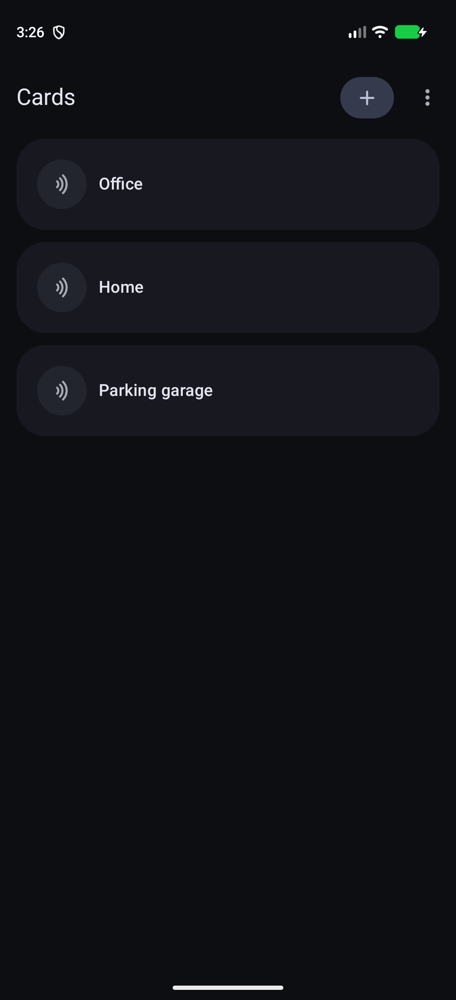
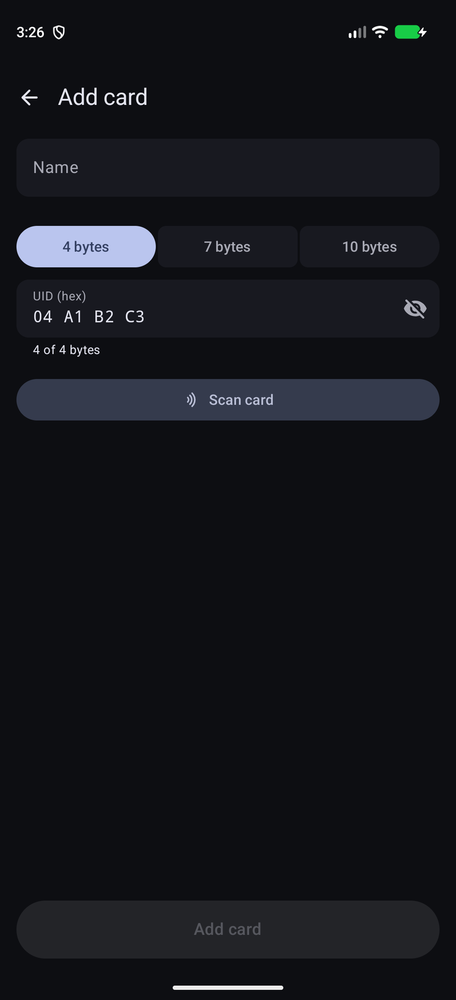

# PixelCardEmulator

English | [简体中文](README.zh-CN.md)

> An NFC Card Emulator that **actually works on Pixel phones, root not required.**

[-3DDC84?logo=android&logoColor=white)](https://developer.android.com)
[](https://kotlinlang.org)
[](#setup)

**PixelCardEmulator** enables NFC-A (ISO 14443-A) card identity (UID) emulation on Google Pixel and select devices without root, unlocking custom UID simulation previously blocked by Android's randomized HCE UID policy.

## Features

- **No Root Required**: Grants the one-time `WRITE_SECURE_SETTINGS` permission through Shizuku, on-device wireless debugging, or computer ADB.
- **Dual Emulation Backends**:
  - **OEM Extension (Android 15+)**: Uses platform `NfcOemExtension.emulateNfcTechnologyATag`.
  - **Raw NCI Fallback**: Direct controller communication via vendor NCI commands with automatic parameter snapshot and restore.
- **UID Support**: 4-byte, 7-byte, and 10-byte NFC-A UIDs.
- **Card Management**: Read cards via NFC, enter hex UIDs manually, set default card, and mask UIDs for privacy.
- **Material 3 Expressive UI**: Dynamic Color, smooth transitions, swipe actions, and haptics.

## Screenshots

These demo screenshots were captured from the Android Emulator. The editor uses the non-sensitive example UID `04 A1 B2 C3`.

<table>
  <tr>
    <td align="center">
      
      <br>
      <sub>Card list with the saved demo card</sub>
    </td>
    <td align="center">
      
      <br>
      <sub>Add a card and edit its example UID</sub>
    </td>
  </tr>
</table>

## Requirements

- **Device**: Google Pixel running **Android 15+** (or compatible Samsung / OnePlus / Sony devices via Raw NCI).
- **Permission**: `android.permission.WRITE_SECURE_SETTINGS` (granted once through one of the setup methods below).

## Setup

1. Install the APK.
2. Open the app and choose one permission setup method:
   - **Shizuku**: Start Shizuku, tap **Grant with Shizuku**, and approve the request.
   - **Wireless debugging**: Tap **Grant with wireless debugging**. In Developer options, open **Wireless debugging** → **Pair device with pairing code**, then enter the code from the setup notification.
   - **Computer ADB**: Run:
   ```bash
   adb shell pm grant io.github.realtvop.pixelcardemulator android.permission.WRITE_SECURE_SETTINGS
   ```
3. Enable NFC, open the app, scan or add your card, and tap to activate.

## Limitations

- **UID Only**: Emulates only the ISO 14443-A UID (`NFCID1`). Does **not** emulate encrypted card data (e.g. MIFARE Classic sectors, DESFire crypto, or bank payment cards).
- **Authorized Use Only**: Use the app only with cards and systems you own or are explicitly authorized to test.
- **On-Device Only**: Network access is used only to connect to Android's wireless ADB service on the same device during permission setup. The app does not upload card UIDs and includes no analytics or telemetry.
- **Raw NCI Safety**: Raw NCI mode temporarily changes NFC controller parameters and automatically snapshots and restores the original configuration.
- **Explicit Permission Grant**: `WRITE_SECURE_SETTINGS` is granted only after the user explicitly chooses Shizuku, wireless debugging, or computer ADB setup.

## Build

```bash
./gradlew assembleDebug
```

## F-Droid preparation

F-Droid listing text, changelog, and emulator screenshots are stored in [`fastlane/metadata/android/`](fastlane/metadata/android/). The [F-Droid build workflow](.github/workflows/fdroid.yml) validates the source build with the F-Droid buildserver container.

### Signed release builds

Create a local keystore and Gradle signing properties when preparing the first release:

```bash
./scripts/prepare-signing.sh
./gradlew assembleRelease
```

Keep `release-keystore.jks` and `keystore.properties` private. For the release workflow, add these repository Actions secrets:

- `ANDROID_KEYSTORE_BASE64`: base64-encoded `release-keystore.jks`
- `ANDROID_KEYSTORE_PASSWORD`
- `ANDROID_KEY_ALIAS`
- `ANDROID_KEY_PASSWORD`

Push a tag such as `v0.1` to build the signed APK and create a draft GitHub release with the APK attached. Every pushed commit also produces an unsigned debug APK in the **Development Build** workflow's Actions artifact; it is not published as a release.

## License

Licensed under the [Apache License 2.0](LICENSE).
