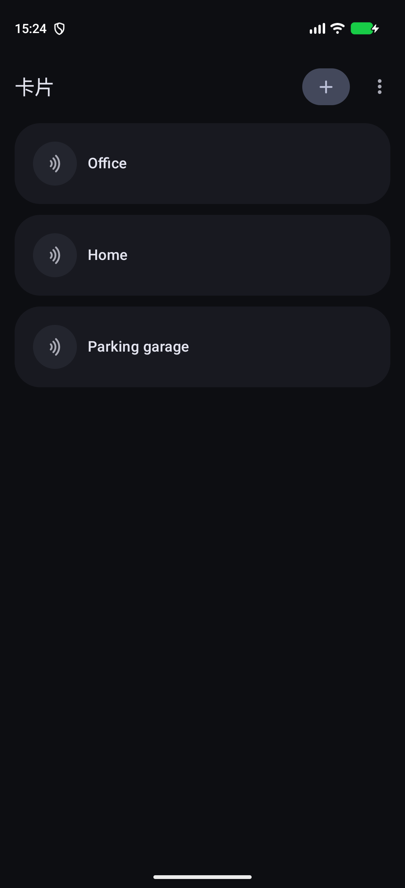
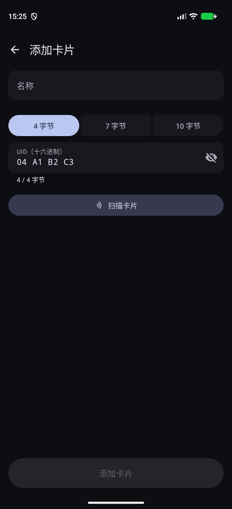

# PixelCardEmulator

[English](README.md) | 简体中文

> 一款**无需 Root、真正能在 Pixel 手机上使用**的 NFC 卡片模拟器。

[-3DDC84?logo=android&logoColor=white)](https://developer.android.com)
[](https://kotlinlang.org)
[](#设置)

**PixelCardEmulator** 可在 Google Pixel 及部分其他设备上无需 Root 即可模拟 NFC-A（ISO 14443-A）卡片标识（UID），突破了 Android 对 HCE 随机 UID 策略的限制，从而支持自定义 UID 模拟。

## 功能特性

- **无需 Root**：可通过 Shizuku、本机无线调试或电脑 ADB 一次性授予 `WRITE_SECURE_SETTINGS` 权限。
- **两种模拟后端**：
  - **厂商扩展（Android 15+）**：使用系统平台的 `NfcOemExtension.emulateNfcTechnologyATag`。
  - **原始 NCI 备用方案**：通过厂商 NCI 命令直接与控制器通信，并自动快照和恢复参数。
- **UID 支持**：支持 4 字节、7 字节和 10 字节的 NFC-A UID。
- **卡片管理**：通过 NFC 读取卡片、手动输入十六进制 UID、设置默认卡片，并可隐藏 UID 以保护隐私。
- **Material 3 Expressive 界面**：动态取色、流畅的过渡动画、滑动操作和触感反馈。

## 演示截图

以下截图来自 Android 模拟器；编辑页使用的是不关联真实卡片的示例 UID：`04 A1 B2 C3`。

<table>
  <tr>
    <td align="center">
      
      <br>
      <sub>已保存示例卡片的列表</sub>
    </td>
    <td align="center">
      
      <br>
      <sub>新增卡片并编辑示例 UID</sub>
    </td>
  </tr>
</table>

## 系统要求

- **设备**：运行 **Android 15+** 的 Google Pixel（或通过原始 NCI 支持的三星、一加、索尼等兼容设备）。
- **权限**：`android.permission.WRITE_SECURE_SETTINGS`（通过以下任一方式授予一次）。

## 设置

1. 安装 APK。
2. 打开应用，选择一种权限设置方式：
   - **Shizuku**：启动 Shizuku，点按“通过 Shizuku 授权”，然后允许请求。
   - **无线调试**：点按“通过无线调试授权”，在开发者选项中打开“无线调试”→“使用配对码配对设备”，再从设置通知中输入配对码。
   - **电脑 ADB**：运行：
   ```bash
   adb shell pm grant io.github.realtvop.pixelcardemulator android.permission.WRITE_SECURE_SETTINGS
   ```
3. 开启 NFC，打开应用，扫描或添加卡片，然后点按卡片即可激活。

## 局限性

- **仅限 UID**：仅模拟 ISO 14443-A 的 UID（`NFCID1`）。**不**模拟加密的卡片数据（例如 MIFARE Classic 扇区、DESFire 加密或银行支付卡）。
- **仅限授权使用**：只能用于自己拥有或已获明确授权测试的卡片和系统。
- **仅在本机处理**：网络权限仅用于设置权限时连接同一设备上的 Android 无线 ADB 服务。应用不会上传卡片 UID，也不包含分析或遥测功能。
- **原始 NCI 安全机制**：原始 NCI 模式会临时修改 NFC 控制器参数，并自动快照和恢复原始配置。
- **主动授予权限**：只有用户明确选择 Shizuku、无线调试或电脑 ADB 设置后，才会授予 `WRITE_SECURE_SETTINGS` 权限。

## 构建

```bash
./gradlew assembleDebug
```

## F-Droid 准备

F-Droid 的商店文案、更新日志和模拟器截图已放在 [`fastlane/metadata/android/`](fastlane/metadata/android/)。[F-Droid 构建 workflow](.github/workflows/fdroid.yml) 会使用 F-Droid buildserver 容器验证源码构建。

### 签名发布构建

准备首次发布时，先生成本地签名文件并验证 release 构建：

```bash
./scripts/prepare-signing.sh
./gradlew assembleRelease
```

请妥善保管 `release-keystore.jks` 和 `keystore.properties`，不要提交到仓库。为发布 workflow 配置以下仓库 Actions Secrets：

- `ANDROID_KEYSTORE_BASE64`：`release-keystore.jks` 的 base64 内容
- `ANDROID_KEYSTORE_PASSWORD`
- `ANDROID_KEY_ALIAS`
- `ANDROID_KEY_PASSWORD`

推送例如 `v0.1` 的 tag 后，workflow 会构建带签名 APK，并创建附带 APK 的 GitHub Draft Release。每次 push commit 也会触发 **Development Build**，生成未签名 debug APK 作为 Actions artifact，但不会发布 Release。

## 许可证

基于 [Apache License 2.0](LICENSE) 授权。
